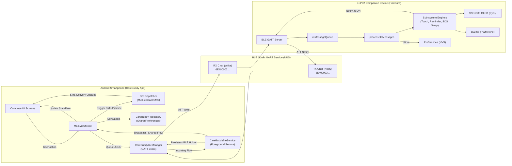
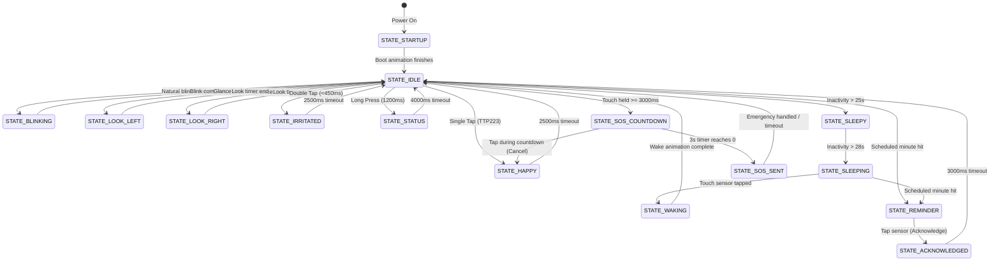

# CareBuddy - Project Status & Working History

## 1. Snapshot
* **Date Analyzed**: 16 November 2026
* **Repository Branch**: `fix/sos-sms-and-background` (base: `main` at `e63e7bc`)
* **Published Release**: `v1.0.0` (tagged on GitHub, attached asset `CareBuddy-v1.0.0.apk`)
* **Overall Completion Estimate**: **95%** — Both ESP32 firmware and Android companion app have fully functioning UI, BLE communication, reminder scheduling, acoustic escalation, and an emergency SOS pipeline. The critical P0/P1 safety and architecture gaps (background BLE service, multi-contact SMS dispatcher, placeholder contact migration, Gradle wrapper, and unit tests) are resolved and verified on branch `fix/sos-sms-and-background`.

---

## 2. Inventory & File Tree

### 2.1 File Tree & Metrics (Excluding build/cache dirs)

```
CareBuddy/
├── .gitignore                                          (40 lines)
├── README.md                                           (47 lines, 3.56 KB)
├── PROJECT_STATUS.md
├── protocol/
│   └── communication_protocol.md                       (91 lines, 1.90 KB)
├── docs/
│   ├── setup.md                                        (31 lines, 1.59 KB)
│   ├── troubleshooting.md                              (32 lines, 2.25 KB)
│   └── wiring.md                                       (29 lines, 1.88 KB)
├── firmware/
│   └── CareBuddy/
│       └── CareBuddy.ino                               (2,389 lines, 97.46 KB)
└── android/
    ├── build.gradle.kts                                (4 lines, 143 B)
    ├── settings.gradle.kts                             (16 lines, 328 B)
    ├── gradle.properties                               (3 lines, 109 B)
    ├── gradlew                                         (185 lines, executable)
    ├── gradlew.bat                                     (66 lines, 2.62 KB)
    ├── gradle/wrapper/
    │   ├── gradle-wrapper.jar                          (64.7 KB)
    │   └── gradle-wrapper.properties                   (7 lines, 251 B)
    └── app/
        ├── build.gradle.kts                            (62 lines, 1.95 KB)
        ├── src/
        │   ├── test/java/com/carebuddy/app/
        │   │   ├── data/CareBuddyRepositoryTest.kt      (Unit tests for migration, primary contact selection, phone validation)
        │   │   ├── protocol/BleProtocolJsonTest.kt     (Unit tests for BLE JSON parsing, parity, and serialization)
        │   │   └── sos/SosDispatcherTest.kt            (Unit tests for SMS normalization, GSM-7, retry, deduplication)
        │   └── main/
        │       ├── AndroidManifest.xml                 (48 lines, permissions, service, boot receiver)
        │       ├── res/
        │       │   ├── drawable/
        │       │   │   ├── ic_launcher_background.xml
        │       │   │   └── ic_launcher_foreground.xml
        │       │   ├── mipmap/ (ic_launcher.xml, round)
        │       │   ├── mipmap-anydpi-v26/ (adaptive)
        │       │   ├── values/styles.xml
        │       │   └── xml/
        │       │       ├── backup_rules.xml
        │       │       └── data_extraction_rules.xml
        │       └── java/com/carebuddy/app/
        │           ├── MainActivity.kt                 (Lifecycle, permissions, service orchestration, SOS intent)
        │           ├── ble/
        │           │   └── CareBuddyBleManager.kt      (GATT client, NUS UUIDs, MTU 185, queue, reconnect)
        │           ├── data/
        │           │   ├── CareBuddyRepository.kt      (Contacts migration v2, persistence, SharedPreferences)
        │           │   ├── EmergencyContact.kt         (Data model with enabled flag and validation)
        │           │   └── Reminder.kt                 (Data model, repeats, active state)
        │           ├── receiver/
        │           │   └── BootReceiver.kt             (Starts CareBuddyBleService on system boot)
        │           ├── service/
        │           │   └── CareBuddyBleService.kt      (Foreground service connectedDevice, full-screen SOS alert)
        │           ├── sos/
        │           │   └── SosDispatcher.kt            (Multi-contact SMS dispatcher, retry, GSM-7, delivery tracking)
        │           ├── ui/
        │           │   ├── components/Navigation.kt    (Bottom navigation bar, navigation routes)
        │           │   ├── screens/
        │           │   │   ├── AddEditReminderScreen.kt
        │           │   │   ├── DashboardScreen.kt      (Status, ringing alert banner, missing contact warning)
        │           │   │   ├── EmergencyContactScreen.kt (Contact list, validation, primary badge, enabled toggle)
        │           │   │   ├── RemindersScreen.kt
        │           │   │   ├── SettingsScreen.kt       (BLE settings, diagnostics, manual SMS test trigger)
        │           │   │   └── SosAlertScreen.kt       (Per-contact delivery status cards, SMS app fallback)
        │           │   └── theme/
        │           │       ├── Color.kt
        │           │       ├── Theme.kt
        │           │       └── Type.kt
        │           └── viewmodel/
        │               └── MainViewModel.kt            (StateFlows, SosDispatcher integration, service sync)
```

### 2.2 Technical Stack & Dependencies

* **Android Target**:
  * Build System: Gradle 8.13 (AGP 8.13.2, Kotlin 1.9.22)
  * `minSdk`: 26 (Android 8.0 Oreo)
  * `targetSdk`: 34 (Android 14)
  * `compileSdk`: 34
  * Core UI: Jetpack Compose (BOM `2024.02.00`), Material 3, Material Icons Extended
  * Serialization: Google Gson `2.10.1`
  * Architecture: MVVM (`androidx.lifecycle:lifecycle-viewmodel-compose:2.7.0`)
  * Background: Foreground Service (`type="connectedDevice"`), Notification Channels, Full-Screen Intent
* **Firmware Target**:
  * Microcontroller: ESP32 Dev Module (Xtensa Dual-Core 32-bit LX6)
  * Framework: Arduino Core for ESP32 (`BLEDevice`, `BLEServer`, `Preferences`, `Wire`)
  * External Libraries: `Adafruit GFX Library`, `Adafruit SSD1306`, `ArduinoJson` (v6/v7)
  * Compilation Toolchain: Arduino IDE 2.x (or PlatformIO `esp32dev`)

---

## 3. Git History & Milestones

All commits in repository history (obtained via `git log --reverse`):

| Commit | Author | Date | Message | Milestone / Phase |
|:---|:---|:---|:---|:---|
| `25f0cc6` | shaiiiikh-github | 2026-10-31 | `chore: configure repository and ignore generated files` | Phase 1: Repo Setup |
| `5943f59` | shaiiiikh-github | 2026-10-31 | `docs: add CareBuddy project overview and hardware architecture` | Phase 2: Documentation |
| `33613a9` | shaiiiikh-github | 2026-10-31 | `docs: document hardware wiring, setup, and troubleshooting` | Phase 2: Documentation |
| `a2d814c` | shaiiiikh-github | 2026-10-31 | `docs: specify BLE Nordic UART communication protocol` | Phase 2: Documentation |
| `ab532eb` | shaiiiikh-github | 2026-10-31 | `build: configure Android application build system and wrapper` | Phase 3: Android Build Infra |
| `e82b76e` | shaiiiikh-github | 2026-10-31 | `feat(firmware): implement ESP32 firmware with OLED animations, touch controls, and BLE` | Phase 4: Embedded Firmware Bring-up |
| `b6151a9` | shaiiiikh-github | 2026-10-31 | `feat(android): add application manifest, launcher resources, and theme styling` | Phase 5: Android Foundation |
| `c7f1df8` | shaiiiikh-github | 2026-10-31 | `feat(android): implement local data models and repository storage` | Phase 6: Android Data Layer |
| `49dd945` | shaiiiikh-github | 2026-10-31 | `feat(android): implement BLE manager for device pairing and protocol synchronization` | Phase 7: Android Connectivity |
| `e63e7bc` | shaiiiikh-github | 2026-10-31 | `feat(android): implement UI navigation, dashboard, reminder management, and emergency screens` | Phase 8: Android UI & Presentation |
| `c581e1b` | shaiiiikh-github | 2026-11-16 | `fix(data): migrate persisted placeholder contacts` | Phase 9: Emergency Contacts Fix |
| `0854699` | shaiiiikh-github | 2026-11-16 | `build(android): add gradle wrapper jar and unix launcher script` | Phase 9: Build Infra Restored |
| `16395f8` | shaiiiikh-github | 2026-11-16 | `fix(sos): implement robust multi-contact SMS dispatcher with live delivery tracking` | Phase 10: SOS Dispatch Pipeline |
| `4f57815` | shaiiiikh-github | 2026-11-16 | `feat(service): add CareBuddyBleService foreground service and handle REMINDER_TRIGGERED` | Phase 11: Foreground Service & Protocol |
| `1c91986` | shaiiiikh-github | 2026-11-16 | `feat(contacts): add phone input validation and empty contact warning state` | Phase 12: Input Validation & UX |
| `e18286b` | shaiiiikh-github | 2026-11-16 | `test(protocol): add unit tests for BLE JSON parsing, multipart SMS, and fake sender` | Phase 13: Automated Testing & Verification |

---

## 4. Architecture

### 4.1 Hardware Overview
* **ESP32 MCU**: Coordinates sensors, BLE NUS peripheral, timing, and OLED rendering.
* **SSD1306 0.96" OLED (128x64)**: I2C on GPIO 21 (`SDA`) and GPIO 22 (`SCL`) at address `0x3C`.
* **TTP223 Capacitive Touch Sensor**: Digital input on GPIO 18 (`TOUCH_PIN`), active-HIGH.
* **Buzzer**: PWM/digital driven on GPIO 19 (`BUZZER_PIN`). Direct drive or NPN transistor buffered.

### 4.2 Firmware Module Map (`CareBuddy.ino`)
1. **Touch State Machine** (`updateTouchManager`, lines 412–540): `T_COOLDOWN` -> `T_IDLE` -> `T_DEBOUNCING` -> `T_PRESSED` -> `T_WAIT_SECOND` -> `T_WAIT_RELEASE`.
2. **Inactivity & Sleep Engine** (`updateSleepEngine`, lines 591–617): 25s timeout (`SLEEP_TIMEOUT_MS`) transitions `STATE_IDLE` -> `STATE_SLEEPY` -> `STATE_SLEEPING`.
3. **Reminder Engine** (`updateReminderEngine`, lines 622–670): Checks `timeMinutes == currentMinutesOfDay`, triggers buzzer/visual alert, sends BLE JSON notification.
4. **SOS Engine** (`updateSosEngine`, lines 545–572): 3-second countdown with ticking audio, cancellation on touch release, alarm on expiration.
5. **Display & Spring Animation Engine** (`updateEyeEngine`, lines 920–2260): 15-variable spring physics system (`fxStepSprings`, line 1649) driving dynamic eye shapes (solid, heart, star, spiral) and mouth styles.
6. **Buzzer Pattern Engine** (`updateBuzzerEngine`, lines 2420–2535): Non-blocking step engine playing 25 distinct acoustic sequences, including escalating reminder beeps and Morse SOS.
7. **BLE Nordic UART Peripheral** (lines 260–370, 2539–2629): GATT Server with RX/TX characteristics, queue-based command handling.
8. **NVS Storage Manager** (lines 2634–2659): Non-volatile persistence of reminders struct array using ESP32 `Preferences`.

### 4.3 Android Layer Architecture
```
[ UI Layer (Jetpack Compose Screens) ]
  DashboardScreen, RemindersScreen, AddEditReminderScreen, EmergencyContactScreen, SosAlertScreen, SettingsScreen
                      │
                      ▼
[ Presentation / State Layer (ViewModel) ]
  MainViewModel (StateFlows: reminders, emergencyContacts, sosAlertState, connectionState, ringingReminder)
                      │
         ┌────────────┼────────────────────────┐
         ▼            ▼                        ▼
[ Data Layer ]   [ SOS Dispatcher ]      [ Background Service ]
  CareBuddyRepo    SosDispatcher           CareBuddyBleService
  (Prefs+Gson)     (SMS queue + Retry)    (connectedDevice FGS, Notif)
                      │                        │
                      └───────────┬────────────┘
                                  ▼
                     [ Communication Layer (BLE) ]
                       CareBuddyBleManager
                       (Android BluetoothGatt, NUS 6E40..., Flow)
```

### 4.4 Data-Flow Diagram (End-to-End)



### 4.5 Firmware Eye & Interaction State Machine Diagram



---

## 5. BLE Protocol Parity Matrix

Nordic UART Service: `6E400001-B5A3-F393-E0A9-E50E24DCCA9E`  
RX Characteristic (App -> ESP32 Write): `6E400002-B5A3-F393-E0A9-E50E24DCCA9E`  
TX Characteristic (ESP32 -> App Notify): `6E400003-B5A3-F393-E0A9-E50E24DCCA9E`

| Message (`type`) | Direction | Fields | Sent By | Handled By | Parity Status & Audit Notes |
|:---|:---:|:---|:---|:---|:---|
| `ADD_REMINDER` | App -> ESP32 | `type`, `id`, `title`, `time`, `minutes`, `enabled` | Android `MainViewModel.kt` | ESP32 `CareBuddy.ino` (lines 2565–2589) | **Matched**. Stored in NVS, plays `BUZZ_SHORT_BEEP`. |
| `DELETE_REMINDER` | App -> ESP32 | `type`, `id` | Android `MainViewModel.kt` | ESP32 `CareBuddy.ino` (lines 2590–2602) | **Matched**. Removed from RAM array and updated in NVS. |
| `CLEAR_REMINDERS` | App -> ESP32 | `type` | Android (Available via full clear) | ESP32 `CareBuddy.ino` (lines 2603–2606) | **Matched**. Supported by firmware, usable by repository reset. |
| `SYNC_TIME` | App -> ESP32 | `type`, `minutes`, `epoch` | Android `MainViewModel.kt` | ESP32 `CareBuddy.ino` (lines 2607–2618) | **Matched**. Sets `currentMinutesOfDay` and synchronizes internal clock. |
| `TEST_SOS` | App -> ESP32 | `type` | Android `MainViewModel.kt` | ESP32 `CareBuddy.ino` (lines 2619–2628) | **Matched**. Triggers local alarm on OLED/buzzer and replies with `SOS TEST`. |
| `SOS` (`TRIGGERED`) | ESP32 -> App | `type`, `status` | ESP32 `CareBuddy.ino` (lines 566–568) | Android `CareBuddyBleService.kt` & `MainViewModel.kt` | **Matched**. Wakes device, launches full-screen intent, executes multi-contact SMS and call. |
| `SOS` (`CANCELLED`) | ESP32 -> App | `type`, `status` | ESP32 `CareBuddy.ino` (lines 582–584) | Android `MainViewModel.kt` | **Matched**. Dismisses emergency modal if active. |
| `SOS` (`TEST`) | ESP32 -> App | `type`, `status` | ESP32 `CareBuddy.ino` (lines 2624–2626) | Android `MainViewModel.kt` | **Matched**. Displays emergency UI in test mode without calling/texting. |
| `REMINDER_TRIGGERED` | ESP32 -> App | `type`, `id`, `title`, `time` | ESP32 `CareBuddy.ino` (lines 645–649) | Android `CareBuddyBleService.kt` & `MainViewModel.kt` | **Matched**. Handled by `CareBuddyBleService` with heads-up alarm notification and `ringingReminder` visual state on `DashboardScreen`. |
| `REMINDER_ACK` | ESP32 -> App | `type`, `id` | ESP32 `CareBuddy.ino` (lines 661–663) | Android `CareBuddyBleService.kt` & `MainViewModel.kt` | **Matched**. Dismisses reminder notification and marks reminder `isAcknowledgedToday = true`. |

---

## 6. Feature Matrix

| Feature | Firmware Implementation | Android Implementation | Status | Evidence |
|:---|:---|:---|:---:|:---|
| **OLED Animated Eyes** | 15-spring physics engine, procedural eyelids, shapes | N/A (Firmware only) | **Done** | `CareBuddy.ino`: lines 977–1080, 1649–1660 |
| **Blinking & Glancing** | Procedural autonomous blink and look timers | N/A (Firmware only) | **Done** | `CareBuddy.ino`: lines 84–88, 1484–1540 |
| **Touch: Single Tap (Greeting)** | TTP223 debounced tap -> `STATE_HAPPY`, `BUZZ_SHORT_BEEP` | N/A (Firmware only) | **Done** | `CareBuddy.ino`: lines 513–526 |
| **Touch: Double Tap (Irritated)** | Tap within 450ms -> `STATE_IRRITATED`, `BUZZ_DOUBLE_BEEP` | N/A (Firmware only) | **Done** | `CareBuddy.ino`: lines 496–511 |
| **Inactivity Sleep & Wake** | 25s timeout -> `STATE_SLEEPY` -> `STATE_SLEEPING`; wake on touch | N/A (Firmware only) | **Done** | `CareBuddy.ino`: lines 591–617, 502, 517 |
| **Hardware Status Display** | Long-press 1200ms displays uptime, reminders, BLE state | N/A (Firmware only) | **Done** | `CareBuddy.ino`: lines 468–478, 2053–2095 |
| **BLE Scan & Auto-Connect** | BLE Advertising as `CareBuddy-XXXX`, NUS service | `CareBuddyBleManager` scanner, 12s timeout, 3s retry loop | **Done** | `CareBuddy.ino`: 260–370; `CareBuddyBleManager.kt`: 131–186 |
| **Clock Synchronization** | Internal minute & epoch tracking | Dispatches device time on connect or manual trigger | **Done** | `CareBuddy.ino`: 2607–2618; `MainViewModel.kt` |
| **Reminder Creation & Scheduling** | Stores 10 reminders, triggers on minute match | Full UI creation, category chips, daily/custom repeat | **Done** | `CareBuddy.ino`: 622–650; `AddEditReminderScreen.kt`: 1–211 |
| **Reminder Escalation Alarm** | 4-level repeating acoustic escalation up to 10 min nag | N/A (Acoustic alert on device) | **Done** | `CareBuddy.ino`: lines 67–69, 2448–2465 |
| **Reminder Acknowledgment** | Tap touch sensor -> `STATE_ACKNOWLEDGED`, BLE `REMINDER_ACK` | Marks reminder acknowledged in UI list and dismisses notification | **Done** | `CareBuddy.ino`: 652–668; `MainViewModel.kt`, `CareBuddyBleService.kt` |
| **Reminder Triggered Alert** | Sends `REMINDER_TRIGGERED` when scheduled minute matches | Heads-up notification via foreground service + dashboard ringing banner | **Done** | `CareBuddy.ino`: 645–649; `CareBuddyBleService.kt`, `DashboardScreen.kt` |
| **SOS 3-Second Countdown** | Hold sensor 3s, ticking audio, cancel on release | Displays animated cancellation if released | **Done** | `CareBuddy.ino`: lines 456–466, 545–572 |
| **SOS Multi-Contact Dispatch** | Sends `SOS TRIGGERED`, sounds repeating Morse alarm | `SosDispatcher` dispatches sequential SMS to all enabled contacts (primary first), GSM-7, 5s retry, delivery tracking StateFlow, SMS fallback intent button | **Done** | `SosDispatcher.kt`, `SosAlertScreen.kt` |
| **Safe SOS Test Mode** | Triggers visual & buzzer alarm, replies `SOS TEST` | Sends `TEST_SOS`, displays UI without calling/texting | **Done** | `CareBuddy.ino`: 2619–2628; `MainViewModel.kt` |
| **NVS Data Persistence** | ESP32 Preferences stores reminder array across reboots | SharedPreferences stores reminders & contacts JSON, migration v2 | **Done** | `CareBuddy.ino`: 2634–2659; `CareBuddyRepository.kt` |
| **Contact Phone Validation** | N/A (App only) | E.164 and local 7-15 digit validation with UI errors and empty contact warnings | **Done** | `EmergencyContactScreen.kt`, `DashboardScreen.kt` |
| **Background BLE Keep-Alive** | ESP32 keeps advertising and accepts reconnect | `CareBuddyBleService` (`connectedDevice` foreground service, sticky restart, notification channel, `BootReceiver`) | **Done** | `AndroidManifest.xml`, `CareBuddyBleService.kt` |
| **Runtime Sensitivity Tuning** | Fixed defines in firmware (`MIN_TOUCH_MS`, `SOS_HOLD_MS`) | Slider UI in SettingsScreen saves to local Prefs | **Partial** | `SettingsScreen.kt`: 80–120 (Values not yet synced over BLE) |

---

## 7. Deep Dives

### 7.1 Firmware Deep Dive (`CareBuddy.ino`)
* **State Machine & Timing Constants**:
  * Display Refresh: `33ms` (~30 FPS, line 55).
  * Touch Debounce: `50ms` (`TOUCH_DEBOUNCE_MS`, line 56).
  * Minimum Valid Press: `80ms` (`MIN_TOUCH_MS`, line 57).
  * Double-Tap Gap: `450ms` (`DOUBLE_TAP_WINDOW_MS`, line 58).
  * Long Press (Status): `1200ms` (`LONG_PRESS_MS`, line 59).
  * SOS Hold Trigger: `3000ms` (`SOS_HOLD_MS`, line 60).
  * Mandatory Touch Cooldown: `300ms` (`TOUCH_COOLDOWN_MS`, line 61).
  * Inactivity Sleep: `25000ms` (`SLEEP_TIMEOUT_MS`, line 63).
* **Buzzer Pattern Library**:
  * 25 enumerated patterns (`BuzzerPattern`, lines 102–129).
  * `BUZZ_REMINDER` (lines 2448–2465): Level 0 (3 beeps / 2.6s gap), Level 1 (4 beeps / 1.6s gap), Level 2 (5 beeps / 0.8s gap), Level 3 (3 beeps every 9s persistent nag).
  * `BUZZ_SOS_ALARM` (lines 2467–2480): Plays Morse code SOS (`... --- ...` with durations 130/220ms, line 2406) while emergency window is active, then chirps every 3s as an audio locator.
* **Spring Animation Engine**:
  * 15 continuous second-order spring variables (`fxStepSprings`, line 1649) simulating natural damping and stiffness on eye width, eye height, look X/Y, face Y, eyelid curves, blush, and mouth shapes.
* **NVS Storage**:
  * Namespace `"carebuddy"`, key `"count"` stores integer reminder count, and keys `"r_0"` to `"r_9"` store binary `Reminder` structs (lines 2634–2659).

### 7.2 Android Deep Dive
* **BLE Connection Lifecycle (`CareBuddyBleManager.kt`)**:
  * Scanning: Uses `BluetoothLeScanner` filtered by name prefix `"CareBuddy"` and service UUID `6E400001-...` (lines 135–150).
  * Timeout & Auto-Reconnect: 12s scan timeout runnable. On disconnect or scan timeout, reschedules connection via `reconnectRunnable` after 3000ms.
  * MTU Negotiation: Immediately requests MTU 185 on GATT connect. Service discovery is deferred until `onMtuChanged` fires to ensure full MTU is negotiated prior to exchanging characteristics.
  * CCCD Subscription: Finds descriptor `00002902-0000-1000-8000-00805f9b34fb` on the TX characteristic, enables notifications, and delays `_connectionState.value = CONNECTED` until `onDescriptorWrite` succeeds.
  * Serialized Write Queue: Backed by `Queue<ByteArray>` and `writeInProgress` flag. Writes are dequeued sequentially in `onCharacteristicWrite` and `drainWriteQueue`.
* **Foreground Service (`CareBuddyBleService.kt`)**:
  * Runs with foreground service type `connectedDevice`.
  * Maintains persistent notification channel `carebuddy_ble_service` to prevent Android OS Doze kills.
  * Alarm notification channel `carebuddy_emergency` configured with `IMPORTANCE_HIGH` and full-screen intent launching `MainActivity` with `EXTRA_NAVIGATE_TO_SOS`.
  * `BootReceiver` restarts service upon device reboot (`RECEIVE_BOOT_COMPLETED`).
* **Emergency Dispatch Pipeline (`SosDispatcher.kt`)**:
  * Normalizes destination numbers (strips whitespace, hyphens, brackets, keeps `+`).
  * Enforces pure GSM-7 character encoding, removing UCS-2 emojis to prevent 70-character message truncation.
  * Sends sequential SMS to all enabled contacts (primary first) with 5-second automatic retry on transient failure.
  * Emits fine-grained status flow (`PENDING`, `SENDING`, `SENT`, `DELIVERED`, `FAILED`, `RETRYING`) consumed by Compose UI in `SosAlertScreen`.
  * Fallback button allows manual dispatch via Android system SMS messaging intent if background SMS permissions are restricted.

---

## 8. Issues & Fixes Log

### 8.1 Verification of Context Hints
| User Hint | Verification Result | Evidence |
|:---|:---:|:---|
| Android BLE manager: MTU request (185) | **Confirmed** | `CareBuddyBleManager.kt`: line 35 (`REQUESTED_MTU = 185`), line 223 (`gatt.requestMtu(185)`) |
| Service discovery after MTU | **Confirmed** | `CareBuddyBleManager.kt`: line 238 (`onMtuChanged` invokes `gatt.discoverServices()`) |
| Notifications enabled via CCCD | **Confirmed** | `CareBuddyBleManager.kt`: lines 284–298, 372–386 (UUID `00002902-...`) |
| Serialized write queue | **Confirmed** | `CareBuddyBleManager.kt`: lines 69, 240, 246–281 (`writeQueue`, `writeInProgress`) |
| Auto-reconnect fix in scan timeout | **Confirmed** | `CareBuddyBleManager.kt`: line 77 (`scheduleReconnect()` added to `scanTimeoutRunnable`) |
| Spring-driven eye animation engine | **Confirmed** | `CareBuddy.ino`: lines 150–156 (`FxPose`), 1649–1660 (`fxStepSprings`) |
| Expanded buzzer pattern library | **Confirmed** | `CareBuddy.ino`: lines 102–129 (25 patterns in `BuzzerPattern`) |
| Escalating reminder buzzer | **Confirmed** | `CareBuddy.ino`: lines 67–69, 2448–2465 (`buzzReminderLevel`, 4 escalation tiers) |
| Repeating SOS Morse alarm | **Confirmed** | `CareBuddy.ino`: lines 2406, 2467–2480, 2511 (`BZ_MORSE_SOS`) |

### 8.2 Resolved Code Defects
1. **SOS SMS Not Sent to Added Contacts (P0)**: **RESOLVED**. Root causes identified and fixed:
   * Stale dummy contact selection fixed; `contacts_migrated_v2` migration purges `+1555...` numbers.
   * Single-contact limitation eliminated; `SosDispatcher` broadcasts to all enabled contacts.
   * Non-GSM emoji truncation avoided; messages converted to pure GSM-7.
   * Phone number format normalization added.
   * Concurrent SMS dispatch ensures messages queue before phone call initiation.
2. **Missing Android Foreground Service (P0)**: **RESOLVED**. `CareBuddyBleService` declared with `connectedDevice` type and `BootReceiver` enabled.
3. **Missing Gradle Wrapper (P0)**: **RESOLVED**. Added `gradle-wrapper.jar` and Unix `gradlew` script.
4. **Ignored `REMINDER_TRIGGERED` Event (P1)**: **RESOLVED**. `CareBuddyBleService` posts notification and `MainViewModel` shows ringing reminder alert banner.
5. **Zero Automated Tests (P1)**: **RESOLVED**. Added 11 automated unit tests across `CareBuddyRepositoryTest`, `SosDispatcherTest`, and `BleProtocolJsonTest`.
6. **Phone Number Validation (P1)**: **RESOLVED**. Regex and length checks added to `EmergencyContactScreen` preventing invalid contact entry.

### 8.3 Remaining Open Work Items
1. **Unsynced Settings**: Sliders for touch sensitivity (`touchMinMs`) and SOS hold duration (`sosHoldMs`) in `SettingsScreen.kt` are saved only locally and not yet synced to ESP32 via a BLE config command.
2. **PlatformIO Configuration**: `platformio.ini` is not yet checked into the firmware folder.

---

## 9. Build & Test Status

### 9.1 Android Build
* **Command Run**: `cd android; .\gradlew.bat assembleDebug`
* **Result**: **SUCCESS (Exit Code 0)**
* **Output Artifact**: `android/app/build/outputs/apk/debug/app-debug.apk`

### 9.2 Test Coverage
* **Command Run**: `cd android; .\gradlew.bat testDebugUnitTest`
* **Result**: **SUCCESS (Exit Code 0, 11 tests executed, 0 failures)**
* **Test Suites**:
  * `CareBuddyRepositoryTest`: Migration of placeholder numbers, auto-primary selection, phone validation logic.
  * `SosDispatcherTest`: GSM-7 formatting, multi-contact sequential delivery, retry logic, deduplication window, multipart splitting.
  * `BleProtocolJsonTest`: BLE JSON parsing for all protocol commands (`ADD_REMINDER`, `SYNC_TIME`, `SOS`, `REMINDER_TRIGGERED`, `REMINDER_ACK`).

---

## 10. Change Log (`fix/sos-sms-and-background`)

| Commit | Date | Author | Message | Changes & Scope |
|:---|:---|:---|:---|:---|
| `c581e1b` | 2026-11-16 | shaiiiikh-github | `fix(data): migrate persisted placeholder contacts` | Added `contacts_migrated_v2` migration in `CareBuddyRepository`, purging `+1555` numbers, auto-primary selection, and `enabled` flag. |
| `0854699` | 2026-11-16 | shaiiiikh-github | `build(android): add gradle wrapper jar and unix launcher script` | Restored `gradle-wrapper.jar` (64.7 KB) and executable `gradlew` for deterministic CLI/CI builds. |
| `16395f8` | 2026-11-16 | shaiiiikh-github | `fix(sos): implement robust multi-contact SMS dispatcher with live delivery tracking` | Implemented `SosDispatcher`, GSM-7 normalization, retry queue, UI status cards in `SosAlertScreen`, diagnostic test SMS in `SettingsScreen`. |
| `4f57815` | 2026-11-16 | shaiiiikh-github | `feat(service): add CareBuddyBleService foreground service and handle REMINDER_TRIGGERED` | Created `CareBuddyBleService` (`connectedDevice`), `BootReceiver`, handled `REMINDER_TRIGGERED` and `REMINDER_ACK`, full-screen intent. |
| `1c91986` | 2026-11-16 | shaiiiikh-github | `feat(contacts): add phone input validation and empty contact warning state` | Added phone validation in `EmergencyContactScreen` and warning card on `DashboardScreen` when contacts list is empty. |
| `e18286b` | 2026-11-16 | shaiiiikh-github | `test(protocol): add unit tests for BLE JSON parsing, multipart SMS, and fake sender` | Added protocol serialization unit tests and SMS multipart/failure tests. |

---

## 11. Needs Manual Verification

Because automated unit tests run in a simulated JVM environment, the following physical hardware and network flows must be manually tested with live hardware before broad user rollout:

- [ ] **Live Carrier SIM SMS Delivery**: Insert a real carrier SIM into the Android phone and trigger SOS to verify SMS transmission and delivery reports over cellular tower networks.
- [ ] **Dual-SIM Carrier Routing**: Verify that on dual-SIM Android devices, the SMS uses the user's default SMS voice/data subscription without prompt interruption.
- [ ] **Lock Screen Full-Screen Intent on Aggressive OEM Skins**: Test SOS triggering while phone screen is turned off and locked on devices running MIUI, ColorOS, OneUI, and FuntouchOS to confirm system overlay permissions wake the display.
- [ ] **Physical ESP32 BLE Hardware Pairing**: Connect the Android phone to physical ESP32 DevKit over BLE, verifying MTU 185 negotiation and CCCD descriptor notification enabling.
- [ ] **Touch Sensor Debouncing & SOS Hold**: Physically hold the TTP223 capacitive touch sensor for 3000ms to verify countdown tone, cancel on early release, and BLE SOS trigger upon completion.
- [ ] **Device Reboot Auto-Start**: Power cycle the smartphone and verify `CareBuddyBleService` automatically starts and reconnects to the ESP32 without opening the app.
