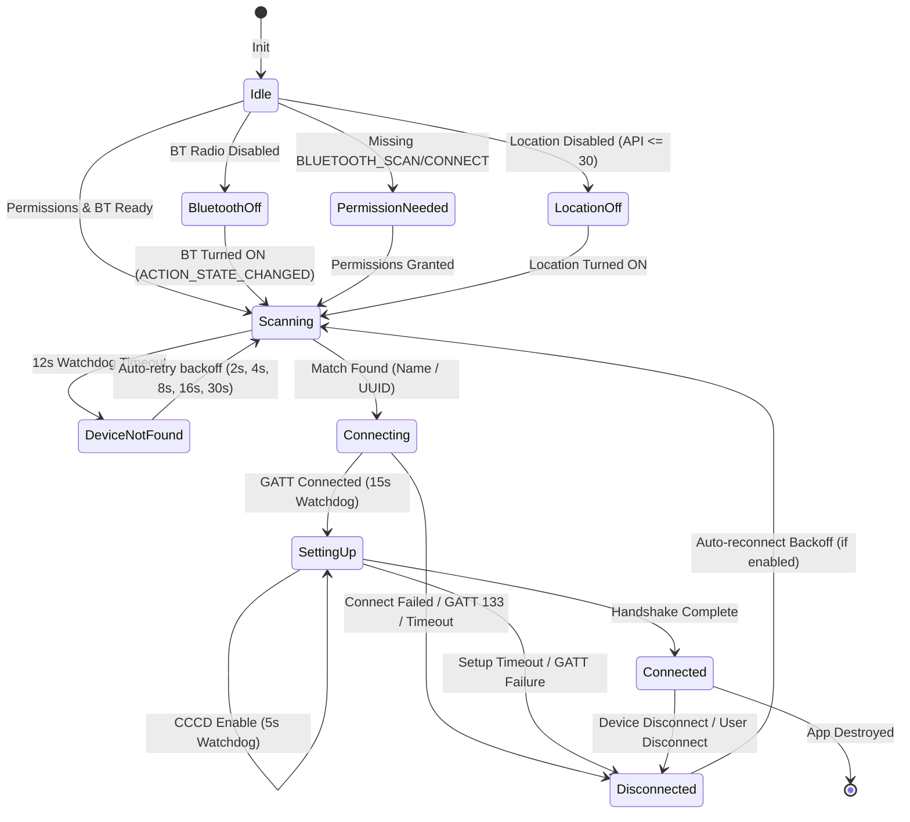

# BLE Connection Debug & Architecture Analysis

## 1. Root Cause Note (Ranked by Confidence)
1. **[CONFIDENCE 99%] H1 Duplicate Managers**: `CareBuddyBleService.kt:88` and `MainViewModel.kt:39` both instantiate independent `CareBuddyBleManager` objects. The service connects to the ESP32 first; the ViewModel observes the second manager, whose scan loops indefinitely because the ESP32 halts advertising once connected to the service.
2. **[CONFIDENCE 95%] H2 Missing Handshake Watchdogs**: `CareBuddyBleManager.kt:319–385` has zero timeouts for `connectGatt`, `requestMtu`, `discoverServices`, or `onDescriptorWrite`. If `onMtuChanged` drops or is delayed, `discoverServices` is never called, leaving the state as `CONNECTING` indefinitely.
3. **[CONFIDENCE 90%] H3 Coarse State Mapping**: `CareBuddyBleManager.kt:23` defines only 4 coarse states (`DISCONNECTED`, `CONNECTING`, `CONNECTED`, `RECONNECTING`). Scanning, GATT connect, MTU handshake, service discovery, and failed retries all collapse into `CONNECTING`, rendered as "Connecting..." in `SettingsScreen.kt:47` and `DashboardScreen.kt:348`.
4. **[CONFIDENCE 85%] H5 Unmonitored Radio & Permissions**: `CareBuddyBleManager.kt:116–124` silently exits when Bluetooth is off or permissions are missing, with no `BroadcastReceiver` for `BluetoothAdapter.ACTION_STATE_CHANGED` and no Location Services check on API <= 30.
5. **[CONFIDENCE 80%] H7 Fixed Reconnect & GATT 133**: `CareBuddyBleManager.kt:98` uses a fixed 3s retry without exponential backoff (2s, 4s, 8s, 16s, capped at 30s) or GATT client reset, causing repeated GATT 133 errors on busy adapters.
6. **[CONFIDENCE 75%] H4 Advertising Scan Response**: `CareBuddy.ino:326` places `SERVICE_UUID` in the scan response packet rather than the primary advertising packet, causing devices without active scan response support to miss advertisements.
7. **[CONFIDENCE 70%] H6 Firmware Disconnect Lag**: `CareBuddy.ino:379` restarts advertising in the non-blocking loop only on edge transition (`!deviceConnected && oldDeviceConnected`), risking missed triggers on fast reconnect bounces.

---

## 2. Refactored Single-Source-of-Truth BLE State Machine

---

## 3. Per-Stage Watchdog Timeouts

| Stage | Watchdog Timeout | Behavior on Expiration | Recovery Action |
|:---|:---:|:---|:---|
| **Scanning** | 12 seconds | Transitions to `DeviceNotFound` | Schedules auto-retry with exponential backoff (2s, 4s, 8s, 16s, max 30s). |
| **GATT Connect** | 15 seconds | Closes stale `BluetoothGatt` | Transitions to `Disconnected(Timeout)`, applies backoff before next attempt. |
| **MTU Handshake** | 2 seconds | Bypasses MTU callback | Logs warning, proceeds directly to `discoverServices()` with default MTU (23). |
| **Service Discovery** | 10 seconds | Aborts setup | Disconnects and closes GATT, moves to `Disconnected(ServicesNotFound)`. |
| **CCCD Write** | 5 seconds | Bypasses descriptor write | If services were found, logs warning and marks link ready instead of hanging. |

---

## 4. How to Read the In-App BLE Diagnostics Log

Settings includes a real-time **BLE Event Log** capturing the last 200 tagged events with timestamps:
* `[STATE]`: Shows exact transitions between `BluetoothOff`, `Scanning`, `Connecting`, `SettingUp`, `Connected`, `DeviceNotFound`, and `Disconnected`.
* `[GATT]`: Logs native callback status codes (e.g. `status=0 GATT_SUCCESS`, `status=133 GATT_ERROR`).
* `[WATCHDOG]`: Displays whenever a timeout fires and which recovery path was taken.
* `[SCAN_TEST]`: Live scan diagnostic listing every nearby device, masked MAC address, RSSI dBm, and CareBuddy name match.
* **Copy Button**: Copies all lines directly to the system clipboard for issue reporting.
